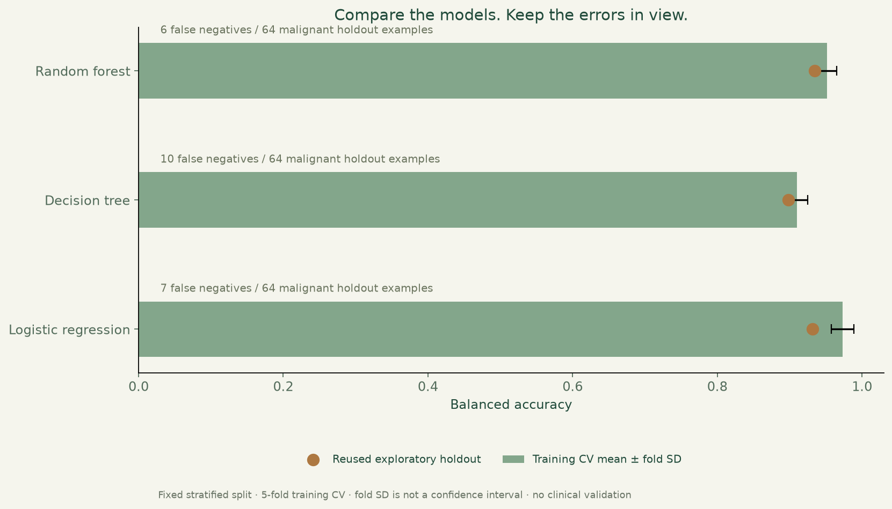

# Breast cancer classification

Compare three classifiers, inspect their mistakes and understand the limits of a single public teaching dataset.



**Python · pandas · scikit-learn · Matplotlib**

[Visual case study](https://benjanning.github.io/projects/projects/machine-learning/) · [Portfolio](https://benjanning.github.io/projects/)

## The investigation

The original coursework notebook explores the Wisconsin Diagnostic dataset. A separate, reproducible portfolio evaluation retains all 30 features, uses a deterministic stratified split and compares logistic regression, a decision tree and a random forest. Preprocessing is fitted inside each training fold.

The point is to explain the errors as well as the scores. Saved predictions, labelled confusion matrices, dataset hashes, exact partitions and dependency versions provide an audit trail. Identifier columns never enter the feature matrix.


Lower-left cells are malignant-labelled examples predicted benign. These errors must remain visible; a high overall accuracy does not make this a diagnostic system.


## Reproduce the evidence

```bash
python -m pip install -r requirements.txt
python evaluate.py
python -m unittest discover -p "test_*.py" -v
python plot_portfolio.py
```

Three regression tests check source/partition integrity, reconcile predictions with metrics and matrices, and reproduce result files byte-for-byte. Results are in [model-comparison.csv](results/model-comparison.csv), [holdout-predictions.csv](results/holdout-predictions.csv), [confusion-matrices.json](results/confusion-matrices.json) and [methodology.json](results/methodology.json). `plot_evaluation.py` remains a compatibility entry point for the current figure generator.

Seed 40, 398 training examples, 171 held-out examples, five stratified training-only cross-validation folds. The chart's error bars show fold standard deviation, not confidence intervals. All three models are compared on the same split; the holdout has also been reused across portfolio iterations. It is exploratory, not an untouched final evaluation or an unbiased model-selection estimate. There is no independent cohort, clinical validation, calibration study or causal feature-importance claim.

## Source and original work

The [UCI Wisconsin Diagnostic dataset](https://archive.ics.uci.edu/dataset/17/breast+cancer+wisconsin+diagnostic) is the public source; the existing CSV is preserved. No clinical decision service is provided. The original `PFDA Project 2.ipynb` and its references remain separate and unchanged in this phase; its historical narrative may differ from later reproducible outputs.

The source release workflow reruns verification and figures, exports commit-identified visuals and a computed result summary, and makes them available to the central portfolio's review-PR synchronisation. [Original documentation and references](COURSEWORK.md) · [Visual provenance](assets/PROVENANCE.md).
