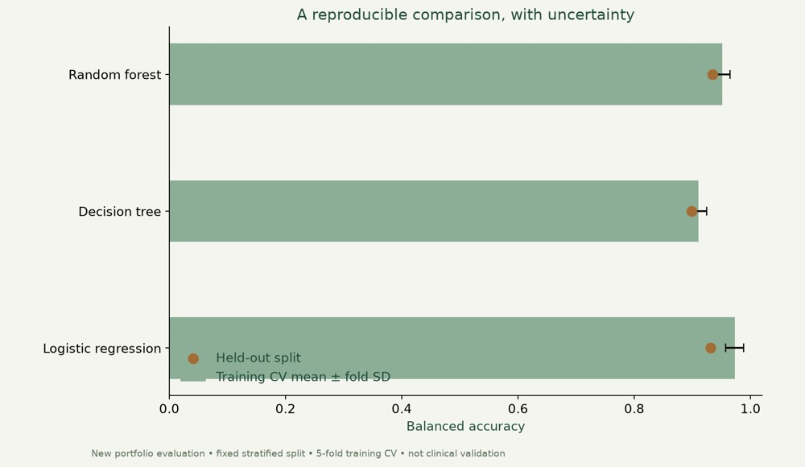

# Breast cancer classification

Explore a public dataset, compare classifiers and examine the limits of model evaluation.



**Python · pandas · scikit-learn · Seaborn**

[Visual case study](https://benjanning.github.io/projects/projects/machine-learning/) · [Main portfolio](https://benjanning.github.io/projects/)

## What it does

Investigated the Wisconsin Breast Cancer dataset in a Python notebook, using exploration, feature selection and several classification methods.

## Key features

- Original dataset exploration, correlations and classifier investigation.
- New deterministic stratified train/holdout split using all 30 features.
- Five-fold training-only cross-validation with preprocessing inside pipelines.
- Saved results, variability and false-negative counts rather than a headline accuracy claim.

## Reproduce the evaluation

```bash
python -m pip install -r requirements.txt
python evaluate.py
```
Open `PFDA Project 2.ipynb` with your Jupyter interface for the original investigation. The requirements include an IPython kernel; install a notebook interface separately if needed.

## Technical details and verification

`evaluate.py` writes results/model-comparison.csv and methodology.json. The preview chart shows measured balanced accuracy, with fold standard deviation (not a confidence interval). The held-out split is reused across model comparisons, so it is exploratory rather than an unbiased model-selection estimate. No clinical or external validation is claimed. The original notebook’s historical narrative may differ from regenerated outputs; the new evaluation is explicitly a portfolio refinement.

[Original documentation and academic references](COURSEWORK.md) · [Visual provenance](assets/PROVENANCE.md)
